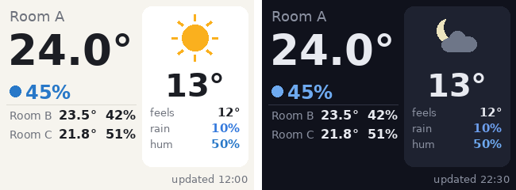

# アイドルダッシュボード Phase 0（ファームウェア変更なし）

Issue #4 / #5 の Phase 0。Muse 側でダッシュボード画像（320x240 JPEG）を作り、
既存の `display.draw_file` / `display.draw_url` で CoreS3 に表示して、
「常時見える室温・天気」が実用になるかを確かめる。ファームウェアは触らない。



## 部品

| ファイル | 役割 |
|---|---|
| `esp32/tools/dashboard_image.py` | JSON ペイロード → 320x240 のベースライン JPEG（Pillow のみ依存、ボード非依存。`--width/--height` で他の画面にも） |
| `esp32/tools/dashboard_sample.json` | ダミーデータのペイロード例 |

ペイロードの形は Issue #4 の案のまま。`condition` は
`clear / partly_cloudy / cloudy / fog / drizzle / rain / snow / thunderstorm`。
配色は昼夜とも暗い色（明るい画面は部屋で眩しいため。`--light` で昼だけ明るい配色）。`is_day: false` で太陽が月になる。`indoor` の先頭が大きく、残りは行で並ぶ。

ラベルに日本語を使うときは CJK フォントが要る（`--font /path/to/NotoSansCJK-Regular.ttc`、
または `fonts-noto-cjk` を入れると自動で拾う）。無ければ英数字のラベルにする。

## ローカルで確認

```sh
pip install pillow
python3 esp32/tools/dashboard_image.py esp32/tools/dashboard_sample.json /tmp/dashboard.png
```

## 実機に出す

### A. Muse の VM で描いて `display.draw_file`（本命）

Muse に次のように頼む（ダミーデータのまま試す）:

> このリポジトリの `esp32/tools/dashboard_image.py` と `esp32/tools/dashboard_sample.json` を
> raw.githubusercontent.com から VM の workspace/ にダウンロードして、
> `pip install pillow` のあと
> `python3 workspace/dashboard_image.py workspace/dashboard_sample.json workspace/dashboard.jpg`
> を実行し、`display.draw_file` で `workspace/dashboard.jpg` を表示して。

`display.draw_file` / `draw_url` が見当たらないと言われたら、コマンド一覧が古いままの可能性がある
（QUICKSTART.md の「ファームを入れ替えてコマンドが増減したとき」参照）。

### B. Mac で描いて `display.draw_url`（VM で Python が使えないとき）

CoreS3 と同じ Wi-Fi の Mac で:

```sh
python3 esp32/tools/dashboard_image.py esp32/tools/dashboard_sample.json /tmp/dash/dashboard.jpg
cd /tmp/dash && python3 -m http.server 8000
```

Muse に「`display.draw_url` で `http://<MacのIPアドレス>:8000/dashboard.jpg` を表示して」と頼む。
平文 http の方がデバイスのメモリ消費が少ない。

## 確認すること（#5 のチェックリスト）

1. 読みやすさ：大きい室温、湿度、他の部屋の行、外気温、更新時刻が 30〜50cm 離れて読めるか
2. 一時表示の挙動：タップ・トーク・メニューで画像が消える → トーク後に再度描かせて戻るか
3. 定期更新：10〜15 分ごとに描き直させたときの割り込み感・消費電力
   （画像を描くと画面スリープが解除されるので、バッテリー駆動中は毎回点灯する点に注意）
4. 昼／夜：`is_day` を切り替えて見え方を比べる

結果は #5 にコメントで記録する。公開リポジトリなので、実際の地名・センサー ID・トークンは書かない。

---

# Phase 1：ファームウェア内のダッシュボード（#6）

`CONFIG_HOMEHUB_DASHBOARD`（CoreS3 の overlay で有効）で、ダッシュボードが UI のタイルになる。
画像ではなく端末が LVGL で描くので、トークやタップで消えても Muse が描き直す必要はない。

- 位置：顔 → 設定 → **ダッシュボード**（設定からさらに左へスワイプ）
- 外気の行は `HOMEHUB_DASHBOARD_JAPANESE`（CoreS3 で有効）で「体感・降水・湿度」
- データ：Muse が `display.show_dashboard` で送る。引数 `payload` は上と同じ JSON を文字列にしたもの
  （`esp32/tools/dashboard_sample.json` の中身をそのまま渡せる）
- 自動復帰：待機中（IDLE）で **USB 給電中**、データが 30 分以内、操作もトークも 60 秒ない
  → ダッシュボードへスライドして戻る。表示中は画面スリープしない
- バッテリー駆動中：自動では戻らず、画面スリープも従来どおり（手でスワイプすれば見られる）
- タップ・トーク・スワイプでダッシュボードを離れる。60 秒たつとまた戻る
- データが 30 分より古いと、右下の更新時刻（データの updated_at）がオレンジになり、自動復帰と常時点灯をやめる
- 左下に現在時刻。端末は時計を持たないので、最後に受け取った `updated_at` の時刻から端末側で進める（起動後、データが届くまでは出ない）
- 最後に受け取ったデータは NVS に保存され、再起動直後から更新時刻をオレンジにして表示される（新しいデータが届くまでは自動復帰も常時点灯もしない）
- スリープ中の画面はデータが来ても点けない（手動で消した画面を勝手に点けないため）

秒数・分数は Kconfig の `HOMEHUB_DASHBOARD_IDLE_S`（既定 60、画面スリープ設定より長ければその半分）と
`HOMEHUB_DASHBOARD_FRESH_MIN`（既定 30）。

## Muse への頼み方（例）

> 10 分ごとに室温と天気を集めて、`display.show_dashboard` の `payload` に
> `esp32/tools/dashboard_sample.json` と同じ形の JSON を文字列で渡して更新して。

コマンドが見当たらないと言われたら、QUICKSTART.md の「ファームを入れ替えてコマンドが増減したとき」を参照。
